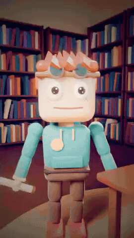
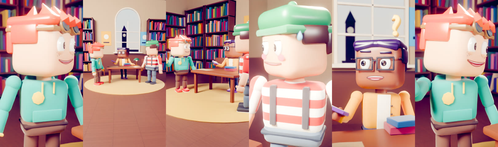
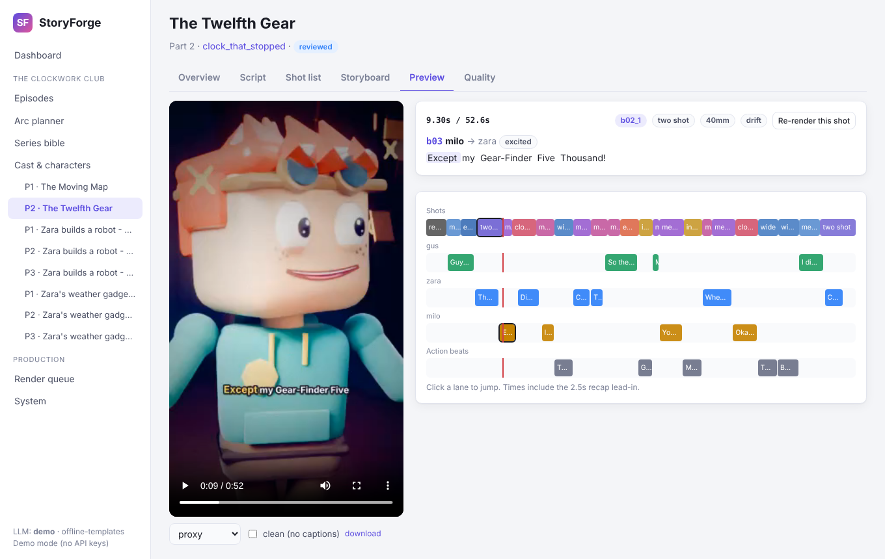
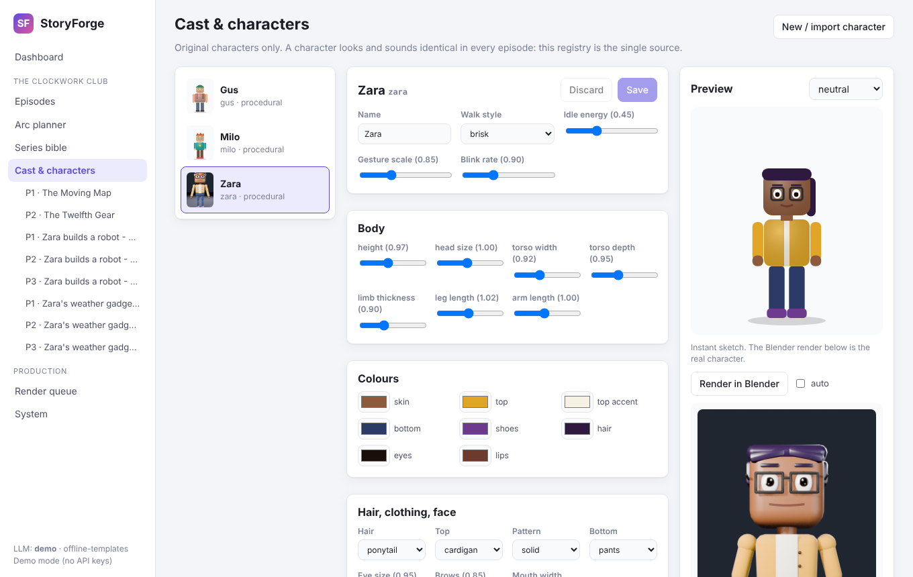
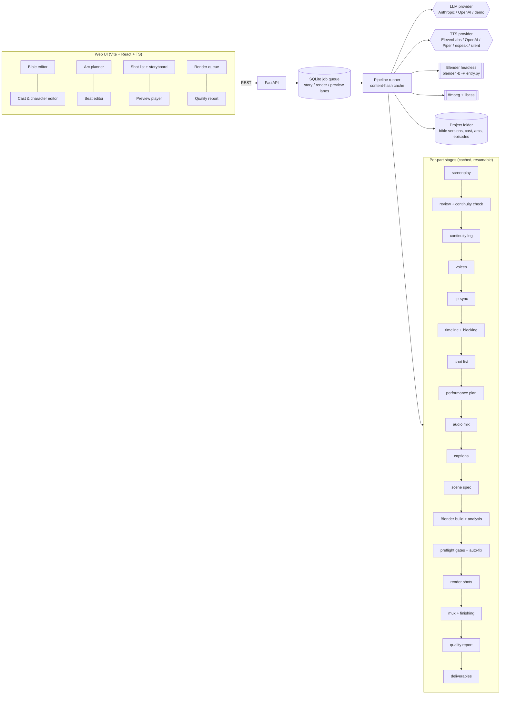
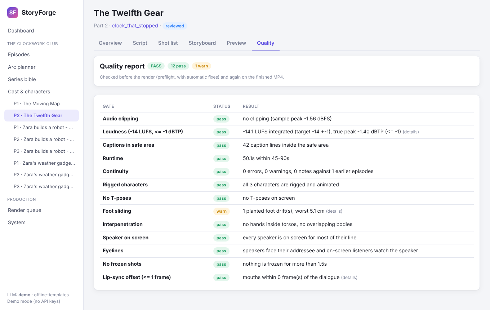

# StoryForge

StoryForge is a production pipeline that turns a story idea into vertical (9:16) animated shorts,
45–90 seconds per part, rendered in Blender. It keeps original characters consistent across a series,
plans multi-part arcs with cliffhangers, and remembers what happened through a versioned series bible.
The target is a short that looks animated, lit, edited and mixed by professionals.

**Output files only.** StoryForge never posts anything and has no social-media integration. Each part
produces a captioned MP4, a clean MP4, an `.srt`, an editable `.blend`, thumbnails and suggested
titles/descriptions/hashtags. Publishing them is up to you.

<p align="center">
  
  &nbsp;&nbsp;
  
</p>
<p align="center"></p>

*Left: proxy preview of the bundled demo (part 1). Right: a `final` preset still (Cycles, 1080×1920).
Bottom: storyboard stills, one per automatically designed shot.*

---

## Contents

1. [What it does](#what-it-does)
2. [Quick start](#quick-start)
3. [Windows setup (Blender, ffmpeg, Rhubarb, GPU)](#windows-setup)
4. [Linux, macOS and Docker](#linux-macos-and-docker)
5. [Using the web UI](#using-the-web-ui)
6. [Architecture](#architecture)
7. [The pipeline, stage by stage](#the-pipeline-stage-by-stage)
8. [Quality gates and auto-fixes](#quality-gates-and-auto-fixes)
9. [Series bible, continuity and multi-part arcs](#series-bible-continuity-and-multi-part-arcs)
10. [LLM and voice providers](#llm-and-voice-providers)
11. [Configuration (.env)](#configuration-env)
12. [Adding characters, animations, sound effects and music](#adding-characters-animations-sound-effects-and-music)
13. [Command line](#command-line)
14. [Tests](#tests)
15. [Design decisions](#design-decisions)
16. [Licensing](#licensing)
17. [Known limitations](#known-limitations)
18. [Project layout](#project-layout)

---

## What it does

- **Series bible**: world, tone, content rules, characters (personality, speech patterns, catchphrases,
  wants, fears), relationships, running gags, locations, look (style, grade, captions) and format. It is
  versioned YAML: every save is a new version you can diff and restore. A **continuity log** is written by
  the LLM after each part, and a **continuity check** runs before anything is voiced or rendered.
- **Arc planner**: 2–5 parts from one idea. Every part has a hook in the first 1–2 seconds, an escalation,
  a mini-payoff and a cliffhanger; the finale lands the arc's payoff. Parts 2+ open with a 2–3 s visual
  recap and show a small "PART N" card.
- **Screenplays** as JSON validated against a JSON Schema (cast, location, time of day, beats with
  speaker, line, emotion, intensity, action, performance note, camera hint, gestures, moves, props,
  emotion FX, sound cues), with retries when the model produces invalid JSON. A **story-editor pass**
  scores hook, clarity, pacing, voice and ending and rewrites weak beats. You can then edit any beat in the
  UI; only the stages affected by your edit re-run.
- **Two visual styles**: *Stylized 3D* (EEVEE drafts, Cycles + denoising for finals, AgX, subtle film
  grain) and *Cartoon* (cel/toon shading with Line Art outlines). Three-point lighting per shot from
  location and time-of-day presets, rim lights, optional night volumetrics, a per-series colour grade, motion
  blur, depth of field on the speaker with focus pulls, vignette.
- **Original characters only**: procedural "blocky toy figures" (bevelled, textured, customizable) with a
  full humanoid armature that is compatible with mocap retargeting, an expression system with blendable
  intensity, and support for importing your own rigged characters (`.blend`, `.fbx`, `.glb`).
- **Animation**: a built-in procedural clip library plus your mocap (Mixamo FBX, CMU BVH) retargeted onto
  the rig, layered on NLA tracks with smooth blending, IK foot locking, collision correction, idle
  micro-motion and breathing (nobody is ever frozen), squash/stretch, anticipation and overshoot scaled by
  intensity, secondary motion on hair and accessories, props attached to hand bones and animated extras.
- **Facial performance**: frame-accurate lip-sync (Rhubarb mouth shapes A–H and X), natural blinking
  (every 2–6 s, on head turns, cuts and emotional beats, slower when sad or tired), gaze (listeners look at
  the speaker, look-aways, saccades, eyes lead head turns), listener reactions and emotion FX (sweat drop,
  tears, anger marks, blush, sparkles, question and exclamation marks, shock lines).
- **Automatic cinematography**: establishing shots, mediums, close-ups, over-the-shoulders, two-shots and
  inserts following film grammar (180° rule, eyelines, no jump cuts, cutting on action), camera moves
  (push-ins, handheld, whip pans, snap zooms, dollies), J/L cuts and 9:16 composition that leaves room for
  captions. You can override any shot and re-render only that shot.
- **Sound**: per-line voice direction, consistent voices per character, word timestamps, a dialogue chain
  (EQ, compression, de-essing, room reverb by location), automatically placed foley and SFX (footsteps on the
  location's surface, whooshes on fast cuts, impacts, cartoon accents), music beds with ducking, stings on
  reveals and cliffhangers, room tone (never digital silence), and a master at **−14 LUFS integrated,
  ≤ −1 dBTP** with no clipping.
- **Captions**: burned-in ASS captions with word-by-word highlight (libass), style presets, kept inside the
  safe area; a clean version and an `.srt` too.
- **Quality gates before the final render**, with automatic fixes, and a quality report per episode.
- **Demo mode**: with no API keys at all, the bundled sample series (*The Clockwork Club*, a 2-part arc
  with hand-written screenplays) renders end to end, with offline Piper voices if available, otherwise
  silent dialogue with captions. It always produces an MP4.

## Quick start

Needs Python 3.11+, ffmpeg, and Blender 4.2 LTS or newer (see the setup sections below).

```bash
git clone <this repository> storyforge && cd storyforge
python -m venv .venv
```

Windows (PowerShell):

```powershell
.venv\Scripts\Activate.ps1
pip install -e ".[piper]"
copy .env.example .env      # then set BLENDER_PATH in .env
python scripts\install_tools.py
storyforge doctor
storyforge serve            # open http://127.0.0.1:8000
```

Linux / macOS:

```bash
source .venv/bin/activate
pip install -e ".[piper]"
cp .env.example .env        # then set BLENDER_PATH in .env
python scripts/install_tools.py
storyforge doctor
storyforge serve            # open http://127.0.0.1:8000
```

Or straight from the command line, without the UI:

```bash
storyforge demo --preset draft          # both parts of the sample arc at 540x960
storyforge demo --preset final          # 1080x1920, Cycles: what you would publish
```

Outputs land in `data/projects/clockwork_club/episodes/<episode>/output/`.

The web UI is prebuilt (`web/dist` is committed), so Node.js is only needed if you change the UI
(`cd web && npm install && npm run build`).

## Windows setup

1. **Python 3.11+** from python.org (tick "Add python.exe to PATH").
2. **Blender** (4.2 LTS or newer; the newest LTS is recommended):
   `winget install BlenderFoundation.Blender` or the installer from blender.org. Then put the path to
   `blender.exe` in `.env`, for example:
   `BLENDER_PATH=C:\Program Files\Blender Foundation\Blender 5.2\blender.exe`.
   StoryForge also finds it automatically in the default install folders.
3. **ffmpeg** with libass (the common Windows builds include it): `winget install Gyan.FFmpeg`, then open a new
   terminal so it is on `PATH` (or set `FFMPEG_PATH`/`FFPROBE_PATH`).
4. **Rhubarb Lip Sync** (optional but recommended): `python scripts\install_tools.py` downloads it into
   `tools\rhubarb\`. Without it, StoryForge estimates mouth shapes from the words and audio, which is clearly
   worse.
5. **Voices**: `pip install -e ".[piper]"` plus `python scripts\install_tools.py` gives you offline Piper voices.
   For the best quality add an `ELEVENLABS_API_KEY` or `OPENAI_API_KEY` to `.env`.
6. **GPU**: an NVIDIA card renders with OptiX (or CUDA) automatically: `RENDER_DEVICE=auto` picks OptiX >
   CUDA > HIP > oneAPI > Metal and falls back to the CPU. Keep your NVIDIA driver current. `storyforge doctor`
   (without `--quick`) launches Blender and reports the device it found. Use `RENDER_WORKERS=1` on a single
   GPU (shots render one after another, each using the whole card).

Everything runs natively on Windows: no Docker, no WSL. Paths with spaces are fine, and caption files are
passed to ffmpeg by relative name so drive letters never break the subtitle filter.

## Linux, macOS and Docker

- **Linux**: install ffmpeg and espeak-ng from your package manager, download Blender from blender.org (or
  `snap install blender --classic`), set `BLENDER_PATH`. NVIDIA (OptiX/CUDA) and AMD (HIP) GPUs work as on
  Windows.
- **macOS**: `brew install ffmpeg` and `brew install --cask blender`; Metal is used for rendering.
- **Headless development without a Blender install**: `pip install bpy` into a separate Python of the version
  that bpy requires and set `BLENDER_PYTHON` to that interpreter. This is how the project was developed and
  tested in CI-like containers; use a real Blender for production.
- **Docker (optional, CPU only)**: `docker build -t storyforge .` then
  `docker run --rm -p 8000:8000 -v "$PWD/data:/app/data" --env-file .env storyforge`. Rendering finals on a CPU
  is slow; the story and audio pipeline and drafts are fine.

## Using the web UI

`storyforge serve` starts the API, the render queue and the UI at http://127.0.0.1:8000 (localhost only by
default: the API can read and write your projects and has no login).

<p align="center"></p>

A typical session, which is also the definition of done for the project:

1. **Dashboard → Open the demo series** (or create your own series from the sample bible and cast).
2. **Arc planner**: describe an idea, choose 2–5 parts, *Plan arc*. Edit any part (hook, escalation,
   mini-payoff, cliffhanger, recap line, location, time of day, cast, music mood) and save.
3. **Write & review all parts**: each part gets a screenplay, a story-editor review, a continuity check
   against the bible and the earlier parts, and a continuity log entry that the next part builds on.
4. **Script** tab of an episode: edit beats (lines, emotion and intensity, actions, gestures, moves, props, FX,
   sound cues, camera hints), reorder, add or delete. Review notes and continuity flags show on the beat they
   concern. *Save & re-check* runs only the affected stages.
5. **Shot list**: change shot types, lenses, moves or subjects; *Re-render* renders just that shot.
   **Storyboard** renders one still per shot so you can check framing quickly.
6. **Render drafts**, watch them in **Preview** (video + shot and speaker lanes + word highlight; click
   a lane to jump; *Re-render this shot*), then **Render finals** (1080×1920).
7. **Quality** shows every gate, what was fixed automatically and anything left to fix.
8. **Render queue** shows progress, ETA, live logs, cancel/retry and downloads for every job.

The **Cast** page edits characters with an instant sketch and an accurate Blender preview render, and
imports your own rigged characters. The **Series bible** page edits everything in the bible, shows the
continuity log, and has a raw YAML editor and the version history with diffs and restore.

<p align="center"></p>

## Architecture



- **Backend**: Python package `storyforge/` (stages, providers, story, audio, cinematography, animation
  planning, quality, API, jobs). **Blender side**: `storyforge_blender/`, a package that runs inside
  Blender and turns a JSON scene spec into a scene. The backend never imports `bpy`; it runs
  `blender -b --factory-startup --python-exit-code 1 -P storyforge_blender/entry.py -- <command>` as a
  subprocess (or `BLENDER_PYTHON entry.py -- <command>` with the bpy module).
- **Data**: everything is plain JSON/YAML under `data/projects/<series>/` so it can be read, diffed and
  edited by hand. Renders, caches and job logs live in `data/` too (git-ignored).

## The pipeline, stage by stage

Each part of an arc is an *episode* that runs these stages in order. Every stage declares its inputs; the
runner hashes them together with the stage version and **the source code of the stage** and skips the stage
when nothing changed. Expensive items are cached individually (each voice line, each lip-sync line, each
retargeted clip, each rendered shot), so editing one line re-voices one line and re-renders only the shots
whose content changed. Interrupted renders resume where they stopped.

| # | Stage | What it does |
|---|---|---|
| 1 | `screenplay` | Writes the part with the LLM from the arc plan, the bible and the continuity of earlier parts (or uses an existing `screenplay.json`). Validated against `screenplay.schema.json` plus semantic checks (cast and locations exist, runtime fits 45–90 s, hook first, cliffhanger last unless finale); invalid output is sent back to the model with the errors, up to `LLM_MAX_ATTEMPTS`. |
| 2 | `review` | Rule-based checks (hook in 1–2 s, line length, dead air, runtime, voice, ending) plus an LLM story editor that scores hook/clarity/pacing/voice/ending and rewrites weak beats (validated like a screenplay; rejected if invalid). Then your edits (`edits.json`) are applied, then the **continuity check** (see below) with auto-fixes. Writes `screenplay.final.json`, `review.json`, `continuity.json`. |
| 3 | `continuity_log` | The LLM writes the continuity entry for this part (summary, what changed, open threads, where objects ended up, lasting character changes) into the bible as a new version. |
| 4 | `voices` | Text-to-speech per line with per-line voice direction built from emotion, intensity, delivery and the performance note; pitch shift per character for distinct voices; word timestamps (provider timings, Whisper, or an energy/syllable heuristic). Cached per line. |
| 5 | `lipsync` | Rhubarb Lip Sync per line (dialog text helps recognition), or a word-based estimator when Rhubarb is missing. Mouth cues A–H, X. |
| 6 | `timeline` | Places beats in time (hook at 0.12 s, pauses by pace and emotion, action beats sized by what happens), attaches words and mouth cues, emits events (gestures, moves, props, FX), and plans **blocking**: marks, entrances and exits, walks with speeds, and partners turning toward each other when needed. |
| 7 | `shots` | The automatic shot designer: chooses coverage per beat (establishing after the hook, two-shots, singles, OTS, inserts on props), lenses for 9:16 (36 mm vertical sensor), camera placement with landmark-based framing and caption-safe headroom, the 180° rule, eyelines and looking room, jump-cut avoidance, cut-on-action, J/L cuts, camera moves and focus pulls. Your shot overrides are merged last. |
| 8 | `performance` | Body animation plan per character as NLA strips: base idle with breathing and weight shifts, locomotion matched to path speed (no foot sliding), gestures and listener reactions scaled by intensity, prop holds on hand bones, squash/stretch and anticipation timing, secondary motion, extras. Facial plan: expressions, blinks, gaze and head look, emotion FX. |
| 9 | `audio_mix` | Dialogue chain per line, room reverb by location, foley/SFX planned from the performance (footsteps at real foot plants on the location's surface, gesture and prop foley, whooshes on whip pans), ambience, mood-matched music with ducking, stings and a cliffhanger pull-out, recap lead-in for parts 2+, room tone, −14 LUFS / −1.5 dBTP master. Stems are kept. |
| 10 | `captions` | ASS captions with word-by-word highlight, wrapped and positioned inside the 9:16 safe area, the "PART N" card and the "PREVIOUSLY..." tag; `.srt`. |
| 11 | `scene` | Compiles everything into one JSON scene spec for Blender (characters, paths, NLA strips, face keys, props, FX, shots with camera and focus keys, per-shot light rigs, style, grade). |
| 12 | `build` | Blender builds the scene (characters, set, lights, cameras, compositor), applies animation (NLA, IK foot lock, collision correction, secondary motion), saves `episode.blend` and writes a frame-sampled **analysis** for the quality gates. |
| 13 | `preflight` | Quality gates before rendering, automatic fixes in the stage that owns each problem, re-check (up to 3 rounds). A final render does not start while gates fail unless you choose to render anyway. |
| 14 | `render` | Renders shot by shot (per-shot cache keys, resumable, `RENDER_WORKERS` Blender processes in parallel), on the GPU when available. |
| 15 | `mux` | Finishing in ffmpeg: grain/vignette/optional LUT, recap montage for parts 2+, graphics, burned-in captions, H.264 High + AAC 48 kHz 256 kb/s, `+faststart`; captioned and clean versions. |
| 16 | `quality` | Runs every gate again on the result (loudness measured on the encoded MP4) and writes `quality/report_<preset>.json` and `.md`. |
| 17 | `deliverables` | Three thumbnail candidates at expressive moments, title/description/hashtag suggestions in the series' tone, the editable `.blend` (relative paths, external files packed), bible bookkeeping. |

**Presets**: `proxy` 270×480 (fastest previews), `draft` 540×960 (EEVEE), `final` 1080×1920 (Cycles +
denoising for Stylized 3D, EEVEE for Cartoon), `final_4k` 2160×3840. 30 or 60 fps (`format.fps` in the
bible).

## Quality gates and auto-fixes

The scene analysis samples every second frame of every shot inside Blender (head, hands, feet, hips and chest
positions, head direction, the head's box in the camera, arm elevation, the camera transform). The gates:

| Gate | Fails when | Automatic fix |
|---|---|---|
| Unrigged / T-pose | a character has no animation, or both arms are horizontal for 0.5 s on screen | fall back from the offending mocap clips to built-in clips |
| Foot sliding | a foot that the animation plan says is planted drifts > 10 cm (warns > 5 cm) | stricter IK foot-lock contact detection for that character |
| Interpenetration | a hand inside the torso, or two bodies overlapping | larger hand-collision margin / wider blocking |
| Speaker on screen | the speaker is off screen for most of their line (reaction shots and inserts excepted) | re-frame that shot on the speaker |
| Eyelines | the speaker's head is turned away from the addressee, or on-screen listeners ignore the speaker | partners turn toward each other earlier |
| Static shots | no camera and no character motion for more than 1.5 s | a slow push-in on that shot |
| Lip-sync offset | the mouth keys Blender will play are more than 1 frame off the dialogue (cross-correlation) | shift that character's mouth keys by the measured offset |
| Audio clipping | any clipped sample | lower the limiter ceiling |
| Loudness | integrated loudness not within −14 ±1 LUFS or true peak above −1 dBTP | re-master |
| Captions safe area | a caption line wider than the safe area or too low | smaller caption font so lines re-flow |
| Continuity | open continuity errors | (fixed in the review stage when possible; otherwise flagged per beat) |
| Runtime | outside 45–90 s (warning) | none |

Fixes never touch shots you overrode yourself, are stored per episode (`autofix.json`,
`shot_overrides.auto.json`) and are tied to the screenplay they were made for: when the script changes they
are dropped and re-derived. During development the eyeline gate caught a real staging problem (characters
facing the camera while being talked to from behind) and the foot-slide gate caught a regression in the fix
for it, before either was rendered.

<p align="center"></p>

## Series bible, continuity and multi-part arcs

- `bible/current.yaml` is what every stage reads; `bible/versions/v0001.yaml...` are immutable versions with
  a timestamp and a message. Restoring an old version saves it as a new version, so history is never lost.
- `arcs` and `episodes` in the bible track every arc and part (`planned` → `scripted` → `rendered`).
- **Continuity log**: after a part's script is locked, the LLM records a summary, changes (relationships,
  objects, secrets, facts), open threads, object states (who holds what, what was lost or broken) and lasting
  character changes. The writer of the next part, the arc planner and the recap card read it.
- **Continuity check** (before voicing and rendering): deterministic rules (objects used after they were lost
  or given away, the previous part's open thread never picked up, kid-safety and real-brand rules, unknown cast
  or locations) plus an LLM continuity supervisor (relationships, forgotten events, out-of-character behaviour,
  secrets). Errors on beats you did not edit by hand are rewritten by the LLM, validated like any screenplay.
  `format.continuity_gate: block` makes remaining errors stop the pipeline (default `warn`).
- **Recaps and part cards**: parts 2+ start with a 2–3 s "previously" montage of settled shots from the
  previous part's key beats and its cliffhanger (desaturated, with a push-in and whooshes on the cuts); if the
  previous part has not been rendered yet, a recap card with the recap line keeps audio, captions and picture
  aligned. A "PART N" badge shows at the start of the story.

## LLM and voice providers

Providers sit behind small interfaces (`storyforge/providers/`), keys live in `.env` (never committed).

**Anthropic (default when `ANTHROPIC_API_KEY` is set)**, via the official `anthropic` SDK:
model `claude-opus-5-5` by default (`ANTHROPIC_MODEL`), adaptive thinking with `ANTHROPIC_EFFORT`
(default `high`), structured outputs (`output_config.format` with a JSON Schema derived from ours; the full
schema is still validated locally), streaming with `get_final_message()`, prompt caching, typed error
handling, and **server-side refusal fallbacks enabled by default**: if Claude declines a request, the API
re-runs it on the model Anthropic recommends for that refusal category (`ANTHROPIC_FALLBACKS=default`, beta
`server-side-fallback-2026-07-01`). Set `ANTHROPIC_FALLBACKS=off` to disable it, or list your own fallback
models (`ANTHROPIC_FALLBACKS=claude-opus-4-8`).

**OpenAI** (`OPENAI_API_KEY`): Chat Completions over REST in JSON mode with the schema in the prompt
(`OPENAI_MODEL`, default `gpt-5.5`), local validation and retry. Because it uses the most common endpoint,
`OPENAI_BASE_URL` can point at Azure proxies or local OpenAI-compatible servers (Ollama, LM Studio, vLLM).

**Demo** (no keys or `STORYFORGE_DEMO=1`): the bundled sample arc and hand-written screenplays, or template
screenplays for new ideas, so everything works offline.

LLM replies are cached on disk by prompt, so re-running a stage whose prompt did not change costs nothing;
*Rewrite from scratch* asks for a fresh variation. Token usage per call is logged to the episode's
`llm_calls.jsonl` and shown on the Overview tab.

**Voices**: `TTS_PROVIDER=auto` uses the first available of ElevenLabs (best quality; per-character voice ids,
character timestamps), OpenAI TTS (`gpt-4o-mini-tts` with per-line `instructions` for voice direction), Piper
(offline neural voices), espeak-ng (robotic fallback), silent (captions only). Each character keeps the same
voice in every episode (cast registry).

## Configuration (.env)

Copy `.env.example` to `.env`; every variable is optional and documented there.

| Variable | Default | Meaning |
|---|---|---|
| `STORYFORGE_DATA_DIR` | `./data` | projects, caches, renders, job database |
| `STORYFORGE_DEMO` | `0` | force demo mode even with keys |
| `LLM_PROVIDER` | `auto` | `auto` / `anthropic` / `openai` / `demo` |
| `ANTHROPIC_API_KEY` | – | enables Claude |
| `ANTHROPIC_MODEL` | `claude-opus-5-5` | Claude model id |
| `ANTHROPIC_EFFORT` | `high` | `low` … `max` |
| `ANTHROPIC_FALLBACKS` | `default` | server-side refusal fallbacks: `default`, `off`, or model ids |
| `OPENAI_API_KEY` | – | enables OpenAI (LLM and TTS) |
| `OPENAI_MODEL` | `gpt-5.5` | chat model for story work |
| `OPENAI_BASE_URL` | api.openai.com | OpenAI-compatible endpoint |
| `OPENAI_REASONING_EFFORT` | – | reasoning effort for reasoning models |
| `LLM_MAX_ATTEMPTS` | `4` | validation retries |
| `TTS_PROVIDER` | `auto` | `auto` / `elevenlabs` / `openai` / `piper` / `espeak` / `silent` |
| `ELEVENLABS_API_KEY`, `ELEVENLABS_MODEL` | –, `eleven_multilingual_v2` | ElevenLabs |
| `OPENAI_TTS_MODEL` | `gpt-4o-mini-tts` | OpenAI TTS |
| `PIPER_PATH`, `PIPER_VOICES_DIR` | –, `tools/piper_voices` | Piper |
| `ESPEAK_PATH` | – | espeak-ng |
| `ALIGNMENT_MODE`, `WHISPER_LOCAL_MODEL` | `auto`, `base.en` | word timing source |
| `BLENDER_PATH` | auto-detected | `blender(.exe)` |
| `BLENDER_PYTHON` | – | dev alternative: a Python with `bpy` |
| `FFMPEG_PATH`, `FFPROBE_PATH` | `PATH` | ffmpeg tools (need libass) |
| `RHUBARB_PATH` | `tools/rhubarb` or `PATH` | Rhubarb Lip Sync |
| `RENDER_DEVICE` | `auto` | `auto` / `OPTIX` / `CUDA` / `HIP` / `ONEAPI` / `METAL` / `CPU` |
| `RENDER_WORKERS` | `1` | parallel Blender render processes per job |
| `RENDER_PRESET`, `RENDER_FPS` | `draft`, `30` | CLI defaults |
| `BLENDER_TIMEOUT` | `7200` | seconds per Blender call |
| `STORYFORGE_HOST`, `STORYFORGE_PORT` | `127.0.0.1`, `8000` | web server |
| `STORYFORGE_WORKERS` | `1` | render jobs that may run at once |

## Adding characters, animations, sound effects and music

Third-party files are **never committed**: each asset folder only has a README and a
`license_manifest.yaml` that records source and license, and the folders are git-ignored otherwise.

- **New original character**: Cast page → *New / import character* → procedural, then shape it in the editor
  (body proportions, colours, hair, clothing and pattern, face, accessories, voice per provider, walk style,
  idle energy, gesture scale, blink rate). Add it to the bible's characters to use it in stories. The sketch
  shows the raw colours; Stylized 3D renders go through AgX, which rolls off bright saturated colours the way
  film does, so a colour reads slightly softer on screen (*Render in Blender* shows the real result).
- **Your own rigged character** (`.blend`, `.fbx`, `.glb`): Cast page → *my rigged character*, upload, and the
  inspector reports the detected bone mapping (Mixamo, Rigify, VRoid, Unreal mannequin and CMU names are
  recognised) and shape keys. Or drop the file into `data/projects/<series>/characters/` (or
  `assets/characters/`) and set `kind: imported` + `import.file` in the cast entry. Imported characters are
  driven through a hidden canonical rig, so every clip, gesture, prop, foot lock and look-at works on them;
  shape keys named after visemes (A–H, X) and expressions drive the face.
- **Mocap** (`assets/animations/`): Mixamo FBX (download "Without Skin"), CMU BVH conversions, or any
  FBX/BVH/GLB. Tags in the manifest (or the file name) decide which story actions a clip performs; a matching
  clip replaces the built-in one, retargeted once and cached. See `assets/animations/README.md`.
- **Sound effects** (`assets/sfx/`) and **music** (`assets/music/`): drop files in, describe them in
  `license_manifest.yaml` (tags / moods). Your files win over the built-in CC0 library whenever their tags
  match. See the READMEs in those folders for the tag names.
- **Fonts** (`assets/fonts/`) for captions and **LUTs** (`assets/luts/`, `.cube`) for the grade.

## Command line

```
storyforge demo [--preset draft] [--parts 1,2] [--style cartoon] [--reset]
storyforge plan-arc --series ID --idea "..." [--parts 2]
storyforge arc --series ID --arc ID [--until continuity_log] [--preset final]
storyforge run --series ID --episode ID [--preset final] [--until STAGE] [--force stage,...] [--shots b03_1]
storyforge serve [--host 127.0.0.1] [--port 8000]
storyforge doctor [--quick]
storyforge assets [--force]          # regenerate the built-in SFX and music library
storyforge schemas                   # export JSON Schemas to storyforge/schemas/
```

Useful run options: `--ignore-gates` (render a final even if gates still fail), `--no-autofix`,
`--duration 5` (cut the timeline for smoke tests), `--fps 12`, `--max-frames N` (debug: N frames per shot),
`--no-render` (story and audio only).

## Tests

```bash
pip install -e ".[dev]"
pytest
```

78 tests cover JSON Schema validation and retry-on-invalid, content-hash caching, timeline building, camera
grammar (180° rule, jump cuts, eyelines, lens conventions, overrides), lip-sync mapping and frame accuracy,
every quality gate on synthetic data with known problems, loudness mastering, the continuity rules, beat-edit
diffs, bible versioning, the LLM providers against mocked transports, the REST API and job queue, and a
**5-second end-to-end smoke render** at 270×480 through every stage (needs Blender; skipped with a clear
message otherwise). Tests run in a temporary data folder and never call paid APIs (keys in `.env` are
ignored during tests).

## Design decisions

**Pipeline**
- *Stages + content hashes instead of a DAG library.* The pipeline is linear per part, so a simple ordered list
  of stages is enough; each stage's cache key includes its own source code, so changing the code of a stage
  re-runs exactly what it affects. Stages that create their own inputs store the key of the state they left
  behind, so a second run is always a cache hit.
- *Blender as a subprocess driven by a JSON scene spec.* Blender's Python is version-specific and crashes take
  the process down; a subprocess isolates both, and the spec is a readable, diffable description of the scene.
  A compatibility layer covers Blender 4.2 LTS to 5.x (EEVEE Next ids, slotted actions, compositor node trees,
  Grease Pencil v2/v3 Line Art).
- *Per-shot rendering.* Shots are the unit of caching, parallelism and resumability; re-rendering one shot never
  touches the others.
- *Finishing in ffmpeg, not Blender's sequencer.* Grain, vignette, LUT, the recap montage, captions and encoding
  are cheap to redo without re-rendering, and libass gives proper word-highlight captions.

**Story**
- *JSON Schema as the contract with the LLM*, validated locally even when the provider enforces a schema, with
  the validator's errors fed back verbatim. Structured outputs reduce retries; local validation keeps the
  constraints that structured outputs cannot express (lengths, ranges, patterns).
- *Rule-based checks first, LLM judgement second.* Hooks, runtime, dead air, kid-safety, brands and object
  continuity are checked deterministically (cheap, always on, demo mode too); the LLM adds the judgement calls.
- *User edits are a diff (`edits.json`) applied after the review*, so re-reviews never overwrite your work and
  only hand-edited beats are protected from automatic rewrites.
- *Continuity is logged when a script is locked, not after the render*, so later parts can be written before
  earlier parts are rendered; the entry is marked rendered later.

**Picture**
- *Original procedural characters* built from bevelled boxes with real materials and a full humanoid armature:
  consistent across episodes by construction, cheap to render, and compatible with mocap retargeting. Faces are
  shader-driven on parts parented to the head bone, so expressions and visemes never deform badly.
- *A canonical clip format* (per-bone rotations relative to a T-pose rest) makes procedural clips, BVH and FBX
  interchangeable; retargeting aligns rest poses by bone direction and normalizes the root by hip height.
- *NLA layering* (base, locomotion, hold, gesture, look, correction, secondary) keeps idle motion alive under every
  action, so characters never freeze; IK foot locking and collision correction run after the layers are combined.
- *Film grammar as code.* Shot sizes, 9:16 lens conventions, landmark-based framing with caption headroom, the 180°
  rule, eyelines and jump-cut avoidance are explicit rules with a validator, so they can be tested.
- *Conversation staging*: partners turn toward each other only as much as needed, capped at 75° from the camera
  side so faces stay readable in a vertical frame.

**Sound**
- *Per-line loudness matching (−18 LUFS) before the bus*, then −14 LUFS integrated for the master with a 4×
  oversampled true-peak limiter at **−1.5 dBTP**: AAC encoding adds overshoot, and measuring the encoded MP4 showed
  −1.0 dBTP was not safe.
- *A built-in CC0 library synthesized at first run* (63 foley sounds, 8 loopable mood beds) means demo mode never
  needs downloads and the repository contains no third-party audio; your files always win.
- *Foley from the animation plan*: footsteps are placed at the clip's real foot plants on the location's surface,
  so sound and picture agree by construction.

**Quality**
- *Gates measure what Blender actually plays* (analysis samples, mouth keys in the spec, the encoded MP4), not the
  plan. Fixes are parameters in the stage that owns the problem, recorded per episode and invalidated with the
  script.

**Providers**
- *Anthropic by default* with adaptive thinking, structured outputs and server-side refusal fallbacks on;
  OpenAI over plain REST so compatible local servers work too; a demo provider so the whole pipeline runs
  without keys.

## Licensing

- StoryForge's code: MIT (see `pyproject.toml`).
- Built-in sound effects and music are synthesized by StoryForge and are CC0. Built-in animation clips are
  procedural (CC0).
- **No third-party assets are in this repository.** Mixamo animations may be used in your projects but not
  redistributed as files: download them yourself into `assets/animations/` (git-ignored). CMU mocap is free for
  all uses (credit mocap.cs.cmu.edu). Piper voices each have their own license (see the voice's `MODEL_CARD`).
  Record source and license of every file you add in the folder's `license_manifest.yaml`.
- **Original characters only.** The sample characters are original; do not import characters, names or logos
  you do not own (no Roblox assets, names or logos). The continuity check flags real brand and product names in
  scripts.
- TTS and LLM output is subject to the terms of the provider you use.

## Known limitations

- Rendering finals on a CPU is slow (a Cycles 1080×1920 frame took ~12 minutes on a 4-core CPU during
  development); use a GPU for finals. Drafts use EEVEE, which needs a GPU for speed as well.
- The procedural character style is deliberately simple (blocky toy figures); stylized realism needs imported
  characters, whose faces only animate if they have viseme/expression shape keys.
- The built-in clip library covers the actions in the schema (walk, run, tiptoe, gestures, reactions); complex
  interactions (hugs, fights, climbing) need your own mocap and still have only approximate contact.
- Interpenetration checks use body proxies (torso cylinders, hips); prop and set collisions are not checked.
- Lip-sync quality depends on Rhubarb; without it, mouth shapes are estimated from text and audio energy.
- The location library has four sets (library, clock tower, hallway, street); new locations reuse those sets with
  different names, props and lighting until you add your own set builders.
- The web UI has no login; keep `STORYFORGE_HOST=127.0.0.1` unless you trust your network.
- Word timings without ElevenLabs timestamps or Whisper fall back to a heuristic (captions may drift slightly).

## Project layout

```
storyforge/            backend package
  api/                 FastAPI app and routes
  jobs/                SQLite job store and lane-based job manager
  pipeline/            runner, cache, context, stages/
  story/               arc planner, writer, review, continuity, demo writer
  providers/           llm/ (anthropic, openai, demo), tts/, alignment
  timeline.py staging.py scene_spec.py
  cinematography/      shot designer, grammar, camera maths, moves
  animation/           clip library, retargeting, performance planner
  performance/         face: lip-sync, blinks, gaze, reactions
  lighting/            three-point presets, grades
  audio/               synthesis library, SFX planner, mixer, DSP
  captions/            ASS/SRT builders
  render/              Blender runner, ffmpeg finishing
  quality/             gates, animation gates, auto-fixes
storyforge_blender/    runs inside Blender: scene builder, characters, rig, NLA, lighting, cameras, analysis
web/                   Vite + React + TypeScript UI (web/dist is the built bundle)
assets/                samples (demo series), asset folders with READMEs and license manifests
scripts/install_tools.py   Rhubarb + Piper voices downloader
tests/                 pytest suite
docs/images/           README media
```
